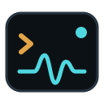
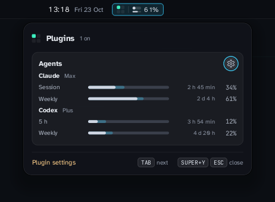

<div align="center">



# agent-notify

### Know what your coding agents are up to, without going to look.

For Claude Code, Gemini CLI, Codex CLI and Antigravity CLI, run in a terminal.<br>
Nothing it learns about your sessions leaves your computer.

[**Get it**](#get-agent-notify) ·
[**What it does**](#what-it-does) ·
[**With Slipstream**](#with-slipstream) ·
[**What it can reach**](#what-it-can-reach)



</div>

## What it does

You set an agent going on something long, and switch to something else. agent-notify is what tells you when it's done, or when it's stuck waiting for you to say yes, and takes you straight back to it. Agents run it from their own hooks, so there's nothing to keep running.

- **A notification when a task finishes, or an agent needs you.** A long task gets a sound; a short one is quiet. Only an agent waiting on you after a long task is critical, so a desktop that honours the notification spec wakes the screen for that and nothing else. Each session's notification replaces its last, and goes away when you send the next prompt.
- **Back to the right window.** Notifications are sent from inside the agent's own processes, so a desktop that looks, as Slipstream does, can take you to the terminal they came from.
- **Plan limits.** `agent-notify usage` reports how much of Claude's, Codex's and Antigravity's limits you've used, and a notification comes as each one passes 75%, 90% and 100%, once per window. The hooks refresh the numbers every few minutes at most, while you're using an agent.
- **Working through a logout.** `agent-notify keep claude` starts a session in the background with your terminal attached to it. Close the window or log out and it carries on working.

It works on any Linux desktop that shows freedesktop notifications. The rest of what it leaves, the notes saying what each session is doing and how to reopen it, is for [Slipstream](#with-slipstream).

## Get agent-notify

**With Slipstream,** the installer asks whether to add it, along with the apps that come with Slipstream. To add it later, run `scripts/install-extras --ask` from Slipstream's download, then turn it on in **Settings → Plugins**.

**On its own,** for any x86-64 Linux:

```sh
curl -LO https://github.com/peterwalker78/agent-notify/releases/latest/download/agent-notify-x86_64.tar.gz
curl -LO https://github.com/peterwalker78/agent-notify/releases/latest/download/agent-notify-x86_64.tar.gz.sha256
sha256sum -c agent-notify-x86_64.tar.gz.sha256
tar -xzf agent-notify-x86_64.tar.gz
install -D agent-notify/bin/agent-notify ~/.local/bin/agent-notify
```

It's one program, built to run on any current distribution. Claude's limits are fetched with `curl`; nothing else needs installing beside it.

**Then wire up your agents:**

```sh
agent-notify setup claude gemini   # the agents you use; with none named, the ones in the config
agent-notify status                # what's configured, wired and listening
```

`setup` adds its hooks to each agent's own settings file, beside any hooks of yours, and keeps a backup of the file first. Codex runs new hooks only once you trust them, in its `/hooks` screen.

**To take it out,** `agent-notify setup --remove` removes every hook it added, and then the program can go.

## With Slipstream

agent-notify is also a plugin for [Slipstream](https://github.com/peterwalker78/slipstream-desktop), and its first: a card in the panel beside the clock, shown above, with your plan limits as gauges, each showing how far through its window you are. The chip by the clock shows the first of them at a glance.

The same hooks leave notes that Slipstream reads:

- **Traces on the faded desktop.** Once the desktop has faded to the wallpaper, each open session has a small oscilloscope trace, so you can see from across the room which agents are still working.
- **Sessions back with your layout.** When a session opens, a note holds the command that reopens it, so Slipstream brings the agent back in its terminal at the next login.
- **Reattached after a logout.** A session started with `agent-notify keep` is still working when you log back in, and Slipstream reattaches its terminal.

## What it can reach

**The hooks** run inside your agent, with your access, and do everything that needs it: they notify over the session bus, write the notes, and refresh the plan limits. Asking for those limits is the only time it reaches past your computer, and only to where each agent's own usage screen asks:

- **Claude:** `api.anthropic.com/api/oauth/usage`, with the login Claude Code already has. The login is only read, never renewed, and goes to `curl` on its standard input, so no process listing shows it.
- **Codex:** `codex app-server`, which asks with its own login.
- **Antigravity:** `agy -p /usage`, the CLI's own readout.

None of these is a documented interface, so each is asked once every few minutes at most, and a refusal leaves the last numbers on show, marked as old.

**The card** only reads. It goes nowhere on the network, sends no notifications and opens no agent's login: it reads the cached limits, the one folder its `plugin.toml` names, and nothing else.

```toml
name = "Agents"
exec = ["bin/agent-notify", "card"]
read = ["$XDG_CACHE_HOME/agent-notify"]
```

The test `the_card_follows_the_usage_cache` runs it the way a desktop does, without the session's runtime folder.

A hook never gets in your agent's way: it prints nothing, always exits successfully, and says what went wrong in `~/.local/state/agent-notify/agent-notify.log` instead.

## Settings

`~/.config/agent-notify/config`, one `key = value` per line, all optional:

```
agents = claude gemini           # the agents setup wires, and whose limits are reported
long-task-secs = 120             # a task this long gets a sound when it finishes
sound-finished = complete
sound-attention = window-attention
usage-agents = claude            # whose limits are reported; every agent above if left out
usage-refresh-secs = 300         # how often the limits are asked for, at most
usage-alerts = 75 90 100         # the levels a limit notifies at
```

`agent-notify --help` lists every command.

## Building

```sh
cargo build --release --locked
cargo test
scripts/package          # dist/agent-notify-x86_64.tar.gz: the plugin folder, packed
```

Every release is built by CI on Debian 13, the oldest system it supports, and attested.

AI coding tools are used in writing agent-notify's code. Every change is built and tested in CI.

## Licence

GPL-3.0-or-later. The licences of the Rust crates built in are in the release's `licences/crates.txt`.
